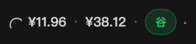
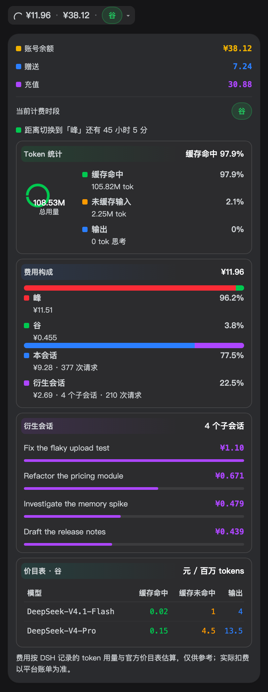
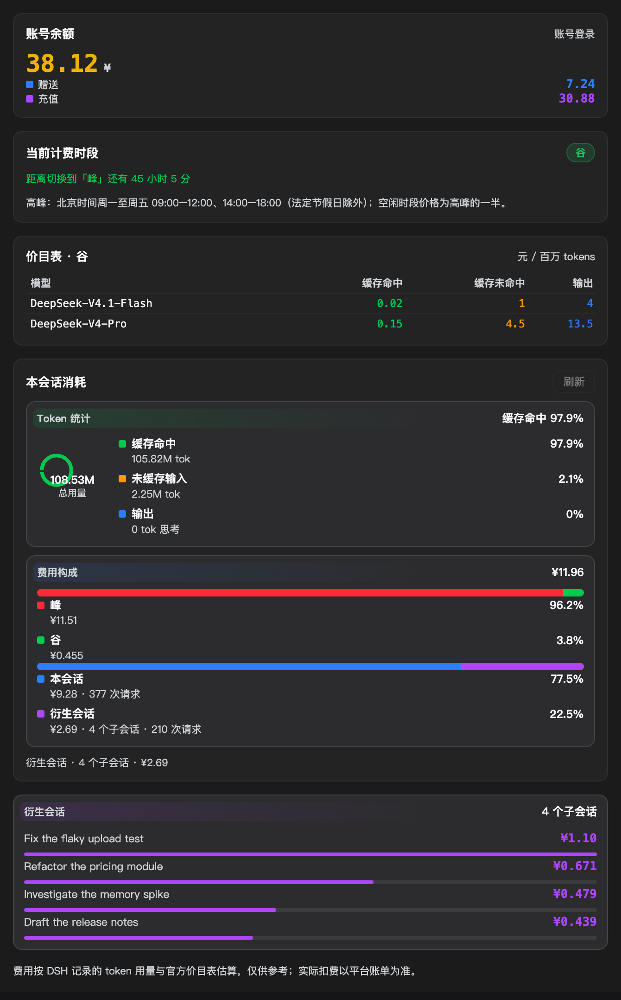
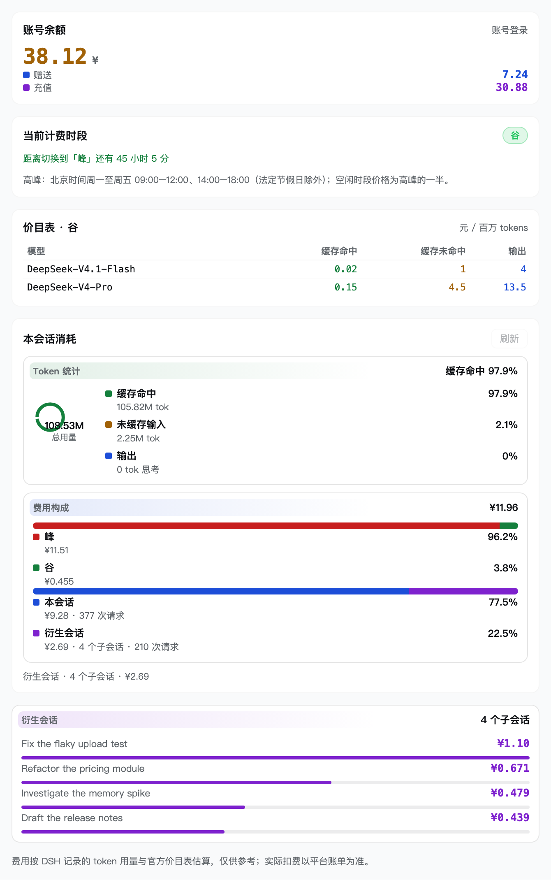

# dsh-cost-breakdown

[](https://dsh-plugin.org/plugins/liaimei/dsh-cost-breakdown)

> **In one line**: install it and DSH shows a persistent **cost breakdown** — under the
> composer and in the right sidebar: what this session has cost, what is left in the
> account, whether you are billing at peak or off-peak, and **how that number is made up**
> (peak/off-peak split, this session vs. its descendants, and the three token buckets:
> cache hit / cache miss / output).

## Two surfaces

**① A persistent readout under the composer** — one line while collapsed:



Click to expand the detail card (balance and period as compact rows, then three titled
cards, always expanded and never folded):



**② A right-sidebar "Usage & Cost" tab** — the same figures, for keeping open:



The light theme follows DSH's own tokens rather than a second hand-written palette:



> All four images are rendered by `npm run shots` from the plugin's **real components and
> real stylesheet**, not hand-drawn: the script loads `lib/client.js`, applies DSH's real
> theme tokens, and screenshots the result — so the images show what actually renders.

The period uses the short Chinese labels **峰 / 谷** with fixed colours: **peak = red**
(the expensive window), **valley = green**.

Both surfaces share **one per-session store**, so they can never disagree and the
expensive session fold never runs twice.

## Why this one: three details that avoid over-billing

Plenty of usage plugins exist. This one spends its effort on **billing correctly**
rather than billing more:

| Detail | What happens if you ignore it | What this plugin does |
|---|---|---|
| **Descendant de-duplication** | A forked / summarized session's log opens with a **copy of its ancestor's events**; summing both bills the same money twice | Bills only the events each session **owns** (skips the `inheritedEventCount` prefix, falls back to the `session/end-seed` marker) and reports the skipped count as `inheritedEventsSkipped` |
| **Three-bucket token pricing** | DSH's `inputTokens` is **cache-miss input only**; treating it as the whole prompt bills the cached prefix at the miss rate and **overstates cost by roughly an order of magnitude** | Prices cacheRead / input / output as three separate buckets |
| **Safe holiday fallback** | If a config yields no usable dates and is read as "no holidays", every holiday bills at the **peak** rate — silently doubling it | Falls back to the built-in holiday table and never silently changes the billing rule |

## Install

From the marketplace or the CLI (the publish profile is `web`):

```bash
dsh plugin --profile web add dsh-cost-breakdown
```

Or straight from the GitHub source — the repository ships the compiled artifacts, so a
source install needs **no build step**:

```bash
dsh plugin --profile web add github:liaimei/dsh-cost-breakdown
```

Then **restart** `dsh web`:

- a persistent **readout appears under the composer** (one cost figure when collapsed;
  click to expand the detail card);
- a **"Usage & Cost" tab appears in the right sidebar's tab strip**.

> **Desktop app note**: the DSH desktop app reads the `desktop` profile, and the
> `dsh plugin` CLI refuses to operate on it by design. On desktop, install this
> directory through the built-in `plugin_manager` tool instead.

### Working on this repository

```bash
npm install
npm run build      # sources are src/*.ts, artifacts are lib/; tsc compiles both halves
```

## Data sources

| Data | Source |
|---|---|
| Balance | Prefers DSH's built-in `deepseekAccount` service (the plugin never touches a token); falls back to `DEEPSEEK_API_KEY` against `api.deepseek.com/user/balance` |
| Usage | The `usage` on `assistant/message` events in DSH session logs (`inputTokens` / `cacheReadTokens` / `outputTokens`), read via `ctx.sessionQuery.observeSession` |
| Prices | The plugin's built-in official price table (`src/pricing.mts` → `lib/pricing.mjs`), because **DSH itself ships no pricing model** |
| Period | Beijing time Mon–Fri 09:00–12:00 and 14:00–18:00 are peak (excluding public holidays); everything else is off-peak, at exactly half the peak rate |

## Billing semantics (important)

DSH's `inputTokens` is the **cache-miss** input; `cacheReadTokens` is the **cache-hit**
input, and `totalTokens` is the sum of all three. A real record:

```
{inputTokens: 192, outputTokens: 238, totalTokens: 13102, cacheReadTokens: 12672}
      192 +         12672      +        238      = 13102
```

Reading `inputTokens` as the whole prompt would bill the cached 12672 tokens at the miss
rate and **overstate the cost by roughly an order of magnitude**. This plugin prices the
three buckets separately.

Costs are **estimates**, computed from DSH-recorded token usage against the official
price table; actual billing is authoritative. Unlisted models still count as requests but
are **not priced**, and the UI says so — they are never quietly treated as free.

## Permissions & external services

What it touches, before you install:

| Item | Detail |
|---|---|
| **Session logs** | Read-only observation of local session events via `ctx.sessionQuery.observeSession(...)`; the lease is released immediately |
| **Account balance** | Prefers DSH's built-in `deepseekAccount` service (**no token touched**); only falls back to a direct `DEEPSEEK_API_KEY` call when signed out |
| **Network** | Exactly two: balance queries against `api.deepseek.com` (official domain). Everything else is local computation — **nothing is reported anywhere** |
| **Local storage** | None. No files written, no database, no cache |
| **Telemetry** | None. No analytics or reporting of any kind |
| **Writes** | None. The plugin is strictly read-only: it never modifies your sessions, config, or code |

## Known limits

- **Holiday table**: ships the 2026 arrangement. Override with the plugin config
  `holidays: ['2026-10-01', ...]` (`YYYY-MM-DD`, Beijing time) or update
  `DEFAULT_HOLIDAYS` in `src/pricing.mts`. **A config that yields no valid date falls back
  to the built-in table** rather than meaning "no holidays" — the latter would bill every
  holiday at the **peak** rate (measurably doubling that day) with no visible sign.
- **Descendant fan-out cap**: at most 400 descendant sessions per walk; beyond that the UI
  marks the statistics as truncated.
- **Sessions not yet on disk**: reading depends on DSH's session query service; unreachable
  logs count as `missing` rather than raising.
- **Public observation API only**: uses `ctx.sessionQuery.observeSession(...)`, **not**
  `Session.snapshotEvents()` — the latter is deprecated in DSH with "new calls are
  prohibited" and would bypass the query service's live-preferred resolution and caching.
- **DSH-internal requests only**: usage from calling the API directly or from other clients
  is not counted.

## License

[MIT](LICENSE) © 2026 liaimei
